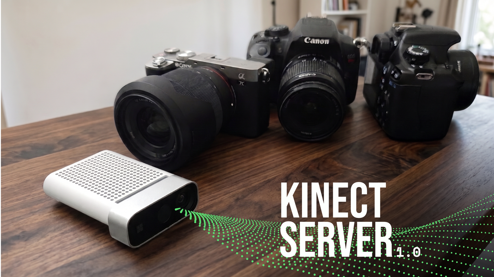

# Azure Kinect Server 1.0



## Introduction 
This project is an extension of a previous C++ exercise, with a core focus on advanced SDK integration and multi-threaded application architecture. It serves as a modern C++ local network API designed to orchestrate an Azure Kinect and multiple DSLR cameras. The primary objective is to build modular, portable classes with strict ownership and encapsulation for hardware control.

A key feature of this server is its **Crow C++ WebSocket integration**, providing a live, bi-directional connection between the client and server without relying on constant HTTP polling. This architecture abstracts the complex hardware execution away from the frontend client. 

The server concurrently streams depth data from the Azure Kinect, utilizing a local `ONNX` AI model to track 32-joint human skeletons. Simultaneously, it maintains connections with up to 5 DSLR cameras via `libgphoto2`, allowing the API to trigger high-resolution captures in parallel.


## Technical Challenges & Solutions

### 1. Concurrent Runtime
Hardware requires multiple processes to run simultaneously without blocking the main execution loop. Listening for WebSocket messages, polling Kinect frames, and triggering DSLR cameras sequentially would cause massive latency.

**Solution:** Multi-threading. The application spawns dedicated `std::thread` workers for the Kinect tracking loop, the camera management loop, and the WebSocket listener, allowing true concurrent execution.

### 2. Synchronization of Communication
Running a multi-threaded C++ program introduces risks of race conditions, deadlocks, and corrupted inter-process communication (IPC).

**Solution:** The architecture safely passes state between threads using `std::mutex` locks, `std::condition_variable` triggers, and `std::atomic` operations, ensuring thread-safe data reads and hardware commands. While maintaining open communication with any connection in the websocket.

### 3. Limited GPU Compute Management
The server machine utilizes an NVIDIA GTX 1050 Ti with only 4GB of VRAM. Running the Azure Kinect body tracking neural network continuously at 30 FPS quickly taxes the system, even when active tracking isn't required by the user.

**Solution:** The system uses `std::condition_variable` to pause the tracking thread when idle, freeing the GPU. 
1. **Idle State:** The Kinect spins up and enters a `wait` status. The thread is `blocked`.
2. **Trigger State:** The API listener receives a WebSocket payload and flips an `std::atomic<bool>` variable. This triggers the condition variable, waking the Kinect thread.
3. **Execution State:** The Kinect enters a `running` status, processes the skeletal data, and upon completion, flips the atomic variable back to `wait`.

Atomic variables are also heavily utilized for graceful `shutdown` signaling. If an OS interrupt (`Ctrl+C`) or terminal error occurs, the atomics ensure the loops exit cleanly, preventing hardware zombies or memory leaks.

### 4. Modernizing C Libraries
While C is highly performant, legacy SDKs lack modern memory safety. The two core hardware libraries used in this project (`k4a` and `libgphoto2`) are C-based and require manual initialization and destruction.

**Solution:** The project wraps raw C pointers in modern C++ `std::unique_ptr` with custom Deleters. This transfers ownership to the C++ compiler, ensuring the hardware resources are automatically and safely released when the pointer goes out of scope (RAII).

```cpp
// Example: Custom Deleters for the Azure Kinect SDK
struct K4aDeviceDeleter {
    void operator()(_k4a_device_t* device) const {
        if (device) {
            k4a_device_stop_cameras(device);
            k4a_device_close(device);
        }
    }
};

struct K4aTrackerDeleter {
    void operator()(_k4abt_tracker_t* tracker) const {
        if (tracker) {
            k4abt_tracker_shutdown(tracker);
            k4abt_tracker_destroy(tracker);
        }
    }
};
```

---

## Prerequisites

**Hardware:**
* Microsoft Azure Kinect (ToF Sensor)
* DSLR Cameras with Gphoto2 support (Canon/Nikon recommended)
* NVIDIA GPU

**Software & Dependencies (Ubuntu 24.04 LTS):**
* **CUDA Toolkit:** `sudo apt-get install nvidia-cuda-toolkit`
* **Azure Kinect SDK & Body Tracking:** 
  *(CRITICAL: The libk4abt tracker requires exactly version 1.4.1 of the base SDK. You must force these versions to prevent an apt dependency standoff).*
  ```bash
  sudo apt-get install libk4a1.4=1.4.1 libk4a1.4-dev=1.4.1 libk4abt1.1 libk4abt1.1-dev k4a-tools=1.4.1
  ```
* **CrowCpp** (WebSockets)
* **nlohmann/json** (JSON parsing)
* **cpr** (HTTP client for API uploads)

---

## Project Structure

**Data Flow:**
`Crow WebSockets` -> `KinectManager` -> `Kinect` -> `PoseChecker`
`Crow WebSockets` -> `CameraManager` -> `CameraClient`


### Core Classes

#### CameraClient
Manages a single DSLR connection, capturing and retrieving images locally.
```cpp
class CameraClient {
private:
  std::unique_ptr<GPContext, ContextDeleter> m_context; 
  std::unique_ptr<Camera, CameraDeleter> m_camera;
  bool m_connected;
  std::vector<std::string> ImagesPaths;
public:
  std::string camera_name;
  int m_photo_count = 0;
  std::string m_save_path;

  bool connect();
  bool isConnected();
  bool capturePhoto(std::string SaveImagePath);
  std::vector<std::string> Get_allImagePaths();
  void Set_image_path(std::string new_image_Path);
};
```

#### CameraManager
Orchestrates parallel triggers across multiple `CameraClient` instances.
```cpp
class CameraManager {
private:
    int TotalPhotoCount;
    std::vector<CameraClient> connectedCameras;
public:
  void ConnnectMultiCamera();
  void MultiCameraCapture();
  std::vector<std::string> Get_allImagePaths();
};
```

#### Kinect
Wraps the raw Microsoft SDK handles in safe unique pointers.
```cpp
class Kinect {
private:
    unique_device m_device;
    unique_tracker m_tracker;
public:
    std::optional<k4abt_body_t> getBodyPosition();
};
```

#### KinectManager
The multi-threaded orchestrator. Manages the WebSocket state, condition variables, JSON formatting, and external API requests (e.g., ImgBB).
```cpp
class KinectManager {
private:
    // Shared Data
    std::atomic<int> correct_pose_count{0};
    
    // Lock and Conditional Variable for Pose Kinect
    std::condition_variable cv;
    std::mutex k4a_mtx;
    
    // Shared Data for Kinect Pose Worker
    bool start = false;
    bool Kinect_shutdown = false;
    PoseState POSE_STATE;
    
    // Client mutex & Message Listener
    std::mutex client_mutex;
    std::atomic<bool> keep_running{true};
    
public:
    bool new_message = false;
    std::mutex msg_mtx;
    std::condition_variable msg_cv;
    std::string message_string;
    
    std::string upload_all_image(const crow::json::rvalue &message);
    void kinect_pose_worker(Kinect AzureKinect, CameraManager &camera_Manager);
    void send_message(const std::unordered_set<crow::websocket::connection *> &active_connections, std::string message);
    void message_listener(const std::unordered_set<crow::websocket::connection *> &active_connections, CameraManager& CamManager);
};
```

---

## Results & Conclusion

This project successfully transitioned from a standard HTTP polling model to an event-driven WebSocket architecture. A live, bi-directional connection provided massive flexibility in sharing JSON data, triggering hardware processes on demand, and blocking idle threads to save GPU cycles.

**Key Takeaways:**
* **Systems Engineering:** Built a highly portable, functional, and thread-safe library capable of future expansion into physical sensors or production environments.
* **Modern C++:** Successfully utilized C++23 standards (Atomics, Mutexes, Condition Variables, Smart Pointers) to abstract away the mental overhead of tracking legacy C memory leaks.
* **Hardware Integration:** Gained practical experience marrying proprietary computer vision SDKs with local network layers.

**Future Work:**
The internal API protocol currently relies on specific string payloads (e.g., checking `"action" == "REVIEW"`). Future iterations will focus on formalizing a stricter, more standard REST-like interface over WebSockets for easier client integration.